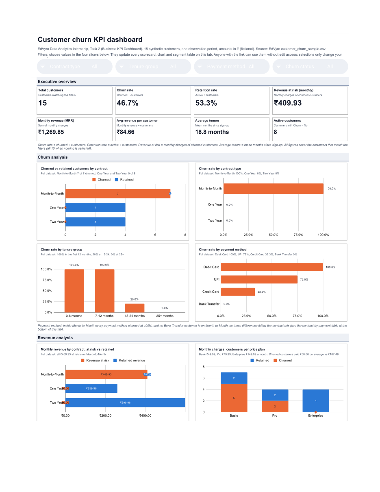
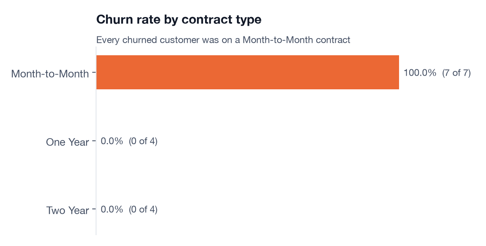

# Business KPI Dashboard — Customer Churn

**EdVyro Data Analytics internship · Task 2 (Business KPI Dashboard)**

An interactive dashboard that explains churn, retention, revenue at risk and customer segments for the official EdVyro customer churn sample, with every number traced back to reproducible, tested code.

## Live dashboards

| Dashboard | Link |
|---|---|
| **Google Sheets dashboard (submission: accepted "spreadsheet dashboard" platform)** | **<https://docs.google.com/spreadsheets/d/1i7BwdceJrBUXdqcdYteQnfCGl6LGgv06dqtX2r1riZY/edit?usp=sharing>** (view-only, filters work without signing in) |
| Web dashboard (HTML + Chart.js, supplementary) | _add your GitHub Pages link here_, or open `dashboard/index.html` in a browser |
| Power BI (optional) | Build kit in `powerbi/`; needs Power BI Desktop on Windows |



The Google Sheet has 4 filters (contract type, tenure group, payment method, churn status), 8 KPI scorecards, 12 charts with a written insight under each, 6 segment tables, an Insights tab and a KPI Check tab that recalculates every KPI with formulas and matches it to the verified Python result. Details: [`spreadsheet/README.md`](spreadsheet/README.md).

## Headline KPIs (15 customers, one observation period, fictional ₹)

| Churn rate | Retention rate | Revenue at risk | Avg tenure | Monthly revenue | ARPU |
|---|---|---|---|---|---|
| **46.7 %** (7 of 15) | **53.3 %** | **₹409.93 / month** (32.3 % of MRR) | **18.8 months** | ₹1,269.85 | ₹84.66 |



## Key findings

1. All 7 churned customers were on **Month-to-Month** contracts; One Year and Two Year had 0 % churn.
2. Every customer with **≤ 12 months' tenure** churned (6 of 6); none beyond 24 months.
3. Every customer with **4+ support tickets** churned (5 of 5); active customers have at most 2.
4. Payment-method differences (Debit Card 100 % → Bank Transfer 0 %) **disappear within each contract type**.
5. These traits describe the same 7 customers, so the data shows *who* left, not *why*. Recommendations are framed as tests.

Full analysis: [`documentation/final_report.pdf`](documentation/final_report.pdf) · [`analysis/business_insights.md`](analysis/business_insights.md) · [`documentation/recommendations.md`](documentation/recommendations.md)

## KPI definitions

| KPI | Formula |
|---|---|
| Churn rate | churned customers ÷ total customers × 100 |
| Retention rate | active customers ÷ total customers × 100 |
| Revenue at risk | Σ MonthlyCharges of customers with Churn = Yes |
| Average tenure | mean TenureMonths |
| ARPU | Σ MonthlyCharges ÷ total customers |

Details and reasoning: [`documentation/methodology.md`](documentation/methodology.md).

## Dashboard pages and filters

1. **Executive overview** — KPI cards, customer split, churn by contract, KPI definitions
2. **Churn analysis** — churned vs retained, churn rate by contract, tenure and payment method
3. **Revenue analysis** — revenue at risk, monthly charges by plan, revenue and ARPU by contract
4. **Customer segmentation** — segment table, contract × payment matrix, tenure / payment / support-ticket segments, customer list
5. **Business insights** — findings, high-risk segments, revenue risk, retention opportunities, recommendations, limitations

Filters: **Contract type · Tenure group · Payment method · Churn status** (all KPI cards and charts update).

## Project structure

```
Business-KPI-Dashboard/
├── data/
│   ├── original_dataset.csv        official EdVyro file, unchanged
│   └── cleaned_dataset.csv         validated + analysis columns
├── analysis/
│   ├── data_analysis.py            profiling, quality checks, cleaning
│   ├── kpi_calculations.py         KPIs, segments, cross-check, dashboard data
│   ├── report_charts.py            report images
│   ├── business_insights.md        findings and recommendations
│   └── outputs/                    quality log, KPI results, segment table, test expectations
├── powerbi/
│   ├── dashboard_guide.md          click-by-click 5-page build + publishing
│   ├── dax_measures.md             all measures + expected values
│   ├── power_query.m               cleaning steps for Power Query
│   └── edvyro_theme.json           report theme (colour-blind-safe)
├── spreadsheet/
│   ├── README.md                   Google Sheets dashboard guide (link, tabs, filters, checks)
│   ├── Customer_Churn_KPI_Dashboard.xlsx        download of the Google Sheet (backup)
│   ├── Customer_Churn_KPI_Dashboard_export.pdf  PDF of all tabs
│   ├── dashboard_tab_export.csv    Dashboard tab values (used by the test)
│   └── screenshots/                signed-out viewer test of the filters
├── dashboard/
│   ├── index.html · style.css · script.js
│   ├── metrics.js                  KPI maths shared with the tests
│   └── data.js                     cleaned rows (generated)
├── documentation/
│   ├── data_cleaning.md · methodology.md · recommendations.md
│   ├── final_report.md / .pdf      11-section business report
│   ├── project_requirements.md     requirement checklist with evidence
│   ├── submission_guide.md         publishing steps + submission checklist
│   └── images/
├── tests/
│   ├── test_pipeline.py            26 data and KPI checks
│   ├── test_dashboard_metrics.js   3,467 web-dashboard-vs-Python checks
│   └── test_spreadsheet_export.py  20 Google-Sheet-vs-Python checks (136 segment cells)
├── requirements.txt
└── README.md
```

## Reproduce

```bash
pip install -r requirements.txt
python analysis/data_analysis.py
python analysis/kpi_calculations.py
python analysis/report_charts.py
python tests/test_pipeline.py
node tests/test_dashboard_metrics.js
python tests/test_spreadsheet_export.py
```

## Data source and disclosure

- Dataset: EdVyro `customer_churn_sample.csv` (<https://edvyro.in/datasets/customer_churn_sample.csv>) — synthetic training data supplied for this task. No alternative dataset was used.
- The EdVyro data guide describes slightly different field names (`monthly_charge`, contracts "Monthly / quarterly / annual"); this project follows the CSV as supplied.
- Limitations: 15 records, no dates, overlapping attributes, descriptive analysis only.

Tools: Google Sheets (formulas, pivot tables, slicers, charts), Python (pandas, matplotlib), JavaScript (Chart.js 4.4.1), Power BI (DAX, Power Query M).
