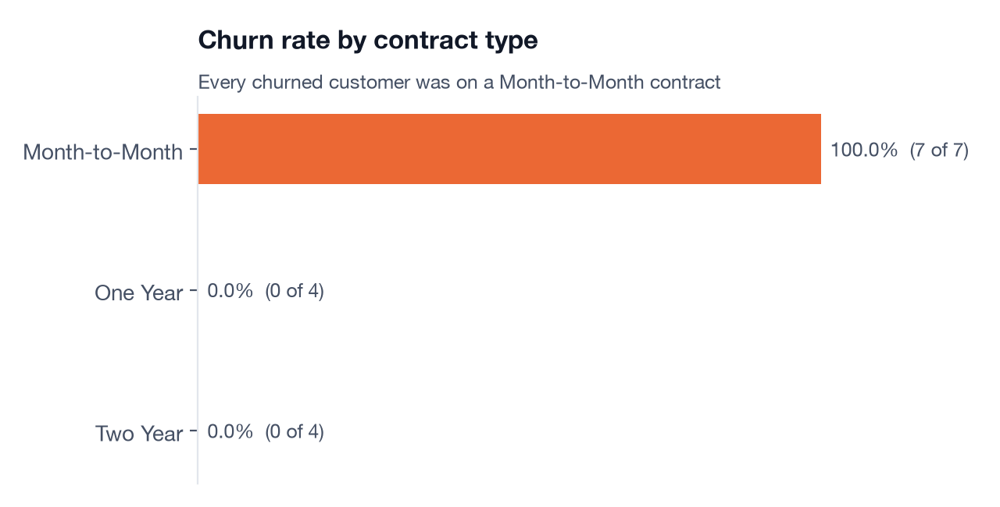
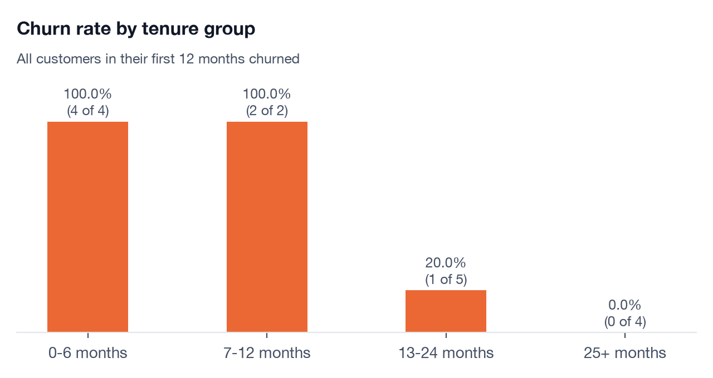
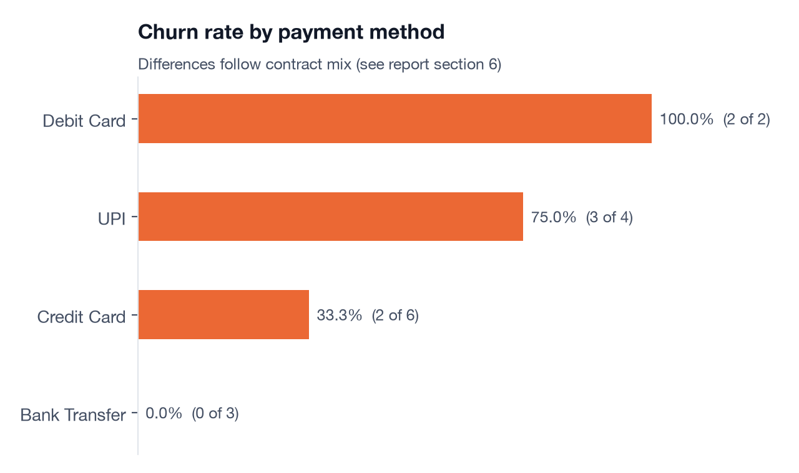
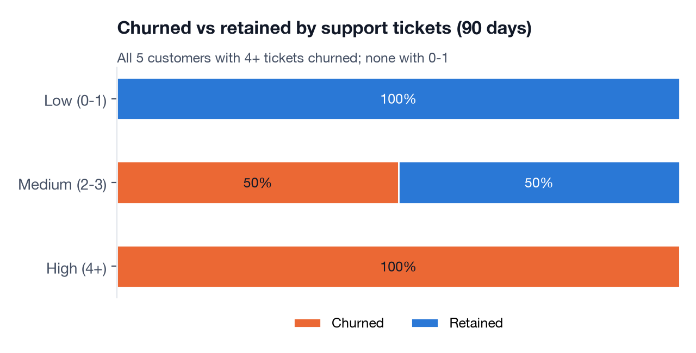
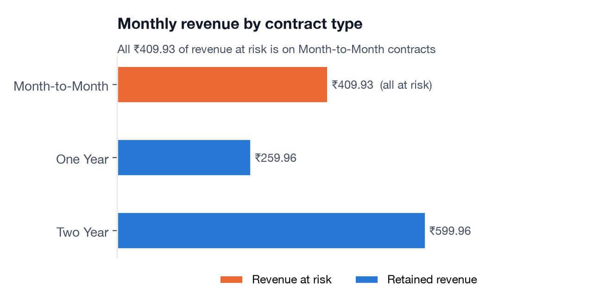

# Customer Churn KPI Dashboard — Business Report

EdVyro Data Analytics internship · Task 2: Business KPI Dashboard · November 2026

---

## 1. Project overview

This project turns the EdVyro customer churn sample into decision-ready KPIs and an interactive dashboard. It covers the four items on the EdVyro Task 2 checklist:

| EdVyro requirement | Where it is met |
|---|---|
| Define churn rate, retention rate, revenue at risk and tenure KPIs | Section 5; `powerbi/dax_measures.md`; dashboard overview page |
| Filters for contract, tenure and payment method | Google Sheets slicers (+ churn status) that view-only visitors can use; web dashboard filter bar; Power BI slicer specification |
| Appropriate charts with clear labels and accessible colours | 12 Google Sheets charts with an insight under each title; web dashboard; colour-blind-validated orange/blue palette |
| Work and a short explanation in one public or view-only link | Published view-only Google Sheets dashboard, linked from the repository README |

Deliverables: a cleaned dataset with a documented quality log, validated KPI calculations, customer segmentation, a published Google Sheets dashboard (<https://docs.google.com/spreadsheets/d/1i7BwdceJrBUXdqcdYteQnfCGl6LGgv06dqtX2r1riZY/edit?usp=sharing>), a working web dashboard, a 5-page Power BI dashboard specification (Power Query, DAX, theme, layout), and this report.

## 2. Business problem

A fictional subscription business is losing customers. Its retention team needs to know **which customer groups to contact first to reduce avoidable churn** (the decision question set in the EdVyro Customer Churn Analysis Guide), how much monthly revenue is exposed, and which observed traits go with churn — without over-claiming what a small sample can show.

## 3. Dataset description

- **Source:** official EdVyro file `customer_churn_sample.csv` (public download, used unmodified; SHA-256 recorded).
- **Size:** 15 customers × 11 columns, one observation period, synthetic records.
- **Columns:** CustomerID, Gender, Age, TenureMonths, SubscriptionType (Basic / Pro / Enterprise), MonthlyCharges, TotalCharges, ContractType (Month-to-Month / One Year / Two Year), SupportTickets (previous 90 days), PaymentMethod (Credit Card / Debit Card / Bank Transfer / UPI), Churn (Yes / No).
- **Currency:** fictional INR (₹), per the EdVyro data guide. Plan prices: Basic ₹49.99, Pro ₹79.99, Enterprise ₹149.99 per month.
- **Note:** the EdVyro data guide lists slightly different field names (e.g. `monthly_charge`, contract values "Monthly / quarterly / annual"). This project follows the CSV as supplied.

## 4. Data cleaning process

Thirteen quality checks were run on the raw file: missing values, blank strings, stray spaces, duplicate rows, duplicate IDs, ID format, numeric parsing, whole-number fields, allowed categories, plausible ranges, `TotalCharges = MonthlyCharges × TenureMonths`, one price per plan, and 1.5 × IQR outliers.

**Result: every check passed.** No rows were removed, no values imputed or capped. Cleaning therefore consisted of type-setting and adding documented analysis columns: `ChurnFlag`, `ChurnStatus`, `TenureGroup` (0-6 / 7-12 / 13-24 / 25+ months), `AgeGroup`, `SupportTicketBand`, `TotalChargesBand`, sort-order columns and a revenue-consistency check column. Nine post-cleaning validation rules all passed. Full detail: `documentation/data_cleaning.md`.

## 5. KPI definitions

Scope: the customers in view (all 15 with no filters), one observation period.

| KPI | Formula | Value |
|---|---|---|
| Total customers | distinct CustomerID | **15** |
| Churned / Active customers | Churn = Yes / No | **7 / 8** |
| Churn rate | churned ÷ total × 100 | **46.7 %** |
| Retention rate | active ÷ total × 100 | **53.3 %** |
| Monthly revenue (MRR) | Σ MonthlyCharges | **₹1,269.85** |
| Revenue at risk | Σ MonthlyCharges of churned customers | **₹409.93** (32.3 % of MRR) |
| Annualised revenue at risk | revenue at risk × 12 (estimate) | ₹4,919.16 |
| Average tenure | mean TenureMonths | **18.8 months** (churned 7.0 · active 29.1) |
| ARPU | MRR ÷ total customers | **₹84.66** |
| Lifetime revenue | Σ TotalCharges | ₹31,327.18 |

**Revenue at risk** is the monthly recurring revenue tied to customers who left during the observation period. The data has no dates or renewal values, so no probability-weighted forecast was made.

All values were confirmed three ways: hand calculation, an independent recomputation from the raw CSV without pandas, and an automated comparison of the web dashboard's own calculations with Python for all 300 filter combinations (3,467 checks, no differences). The Google Sheets dashboard recalculates the KPIs with sheet formulas, and all 17 match the Python results (KPI Check tab and `tests/test_spreadsheet_export.py`).

## 6. Customer churn analysis

**Contract type** is the clearest divider: all 7 Month-to-Month customers churned (100 %); none of the 8 One Year or Two Year customers did.

**Tenure:** every customer in their first 12 months churned (6 of 6). Churn falls to 20 % (1 of 5) at 13–24 months and 0 % (0 of 4) beyond 24 months.

**Payment method:** raw churn rates differ widely — Debit Card 100 %, UPI 75 %, Credit Card 33.3 %, Bank Transfer 0 % — but the cross-tabulation below shows this follows the contract mix:

| Contract | Bank Transfer | Credit Card | Debit Card | UPI |
|---|---|---|---|---|
| Month-to-Month | – | 100 % (2) | 100 % (2) | 100 % (3) |
| One Year | 0 % (2) | 0 % (1) | – | 0 % (1) |
| Two Year | 0 % (1) | 0 % (3) | – | – |

Within each contract type, payment method makes no difference, and no Bank Transfer customer is on Month-to-Month.

**Support contact:** all 5 customers with 4+ tickets in 90 days churned; none of the 6 with 0–1 tickets did. Churned customers averaged 4.3 tickets vs 1.0 for active customers.

## 7. Revenue analysis

- Revenue at risk is **₹409.93 a month (32.3 % of MRR)** — about ₹4,919 a year if none is won back.
- The share of revenue lost (32.3 %) is lower than the share of customers lost (46.7 %) because churned customers paid less: **₹58.56 a month on average vs ₹107.49** for active customers.
- By plan: Basic contributes ₹249.95 (61.0 %) of revenue at risk, Pro ₹159.98 (39.0 %), Enterprise nothing.
- By tenure: customers in their first 12 months carry ₹329.94 (80.5 %).
- Two Year customers hold ₹599.96 (47.2 %) of MRR with 0 % churn; One Year and Two Year together hold 67.7 %.
- ARPU by contract: Month-to-Month ₹58.56, One Year ₹64.99, Two Year ₹149.99.
- Churned customers' lifetime charges total ₹3,109.51, only 9.9 % of all lifetime revenue, because they left early.

## 8. Customer segmentation

| Segment | Customers | Churn rate | Monthly revenue | Revenue at risk | Share of risk |
|---|---|---|---|---|---|
| **Contract** — Month-to-Month | 7 | 100 % | ₹409.93 | ₹409.93 | 100 % |
| One Year | 4 | 0 % | ₹259.96 | ₹0.00 | 0 % |
| Two Year | 4 | 0 % | ₹599.96 | ₹0.00 | 0 % |
| **Tenure** — 0-6 months | 4 | 100 % | ₹199.96 | ₹199.96 | 48.8 % |
| 7-12 months | 2 | 100 % | ₹129.98 | ₹129.98 | 31.7 % |
| 13-24 months | 5 | 20 % | ₹339.95 | ₹79.99 | 19.5 % |
| 25+ months | 4 | 0 % | ₹599.96 | ₹0.00 | 0 % |
| **Payment** — Debit Card | 2 | 100 % | ₹159.98 | ₹159.98 | 39.0 % |
| UPI | 4 | 75 % | ₹199.96 | ₹149.97 | 36.6 % |
| Credit Card | 6 | 33.3 % | ₹629.94 | ₹99.98 | 24.4 % |
| Bank Transfer | 3 | 0 % | ₹279.97 | ₹0.00 | 0 % |
| **Tickets** — High (4+) | 5 | 100 % | ₹279.95 | ₹279.95 | 68.3 % |
| Medium (2-3) | 4 | 50 % | ₹259.96 | ₹129.98 | 31.7 % |
| Low (0-1) | 6 | 0 % | ₹729.94 | ₹0.00 | 0 % |

- **Highest-churn segments:** Month-to-Month; tenure 0–12 months; 4+ tickets (each 100 %).
- **Best-retained segments:** One Year and Two Year contracts; 25+ months' tenure; Enterprise plan; Bank Transfer; 0–1 tickets (each 0 %).
- **Largest revenue risk:** Month-to-Month (100 % of revenue at risk), then 0–6 months' tenure (48.8 %) and Basic plan (61.0 %).
- **Overlap:** these segments describe largely the same 7 customers. The 7 churned customers are exactly the 7 Month-to-Month customers, with tenure 2–14 months and 3–6 tickets; active customers have 15–48 months and 0–2 tickets.

## 9. Key findings

1. Nearly half the customers churned (7 of 15, 46.7 %); 32.3 % of monthly revenue is at risk.
2. All churn sits in Month-to-Month contracts; longer contracts had no churn.
3. Churn is concentrated in the first 12 months of tenure.
4. Heavy support contact (4+ tickets) went with churn in every case.
5. Payment-method and plan differences disappear within each contract type; they are not separate drivers in this data.
6. Because the traits overlap and the sample is 15 records, the data shows **who** left, not **why**.

## 10. Business recommendations

| # | Audience | Decision | Evidence | Next measurement |
|---|---|---|---|---|
| 1 | Retention team | Pilot a One Year upgrade offer for new Month-to-Month customers | 100 % vs 0 % churn; 100 % of revenue at risk | Churn of offer vs comparison group, 3 months |
| 2 | Customer success | Onboarding check-ins at months 1, 3, 6, 12 | 6/6 customers ≤ 12 months churned; 80.5 % of risk | Churn by tenure band for next cohort |
| 3 | Support lead | Escalate customers reaching 3 tickets in 90 days | 4+ tickets: 5/5 churned; 4.3 vs 1.0 average tickets | Churn and resolution time of flagged customers |
| 4 | Account managers | Check in with CUST-1006 and CUST-1009 before renewal | Most tickets among active customers; ₹129.98 MRR | Renewal outcome |
| 5 | Product / pricing | Review Basic/Pro first-months experience | Basic 71.4 % churn, 61.0 % of risk | Churn by plan within contract type |
| 6 | Analytics team | Collect dates and ticket reasons; re-run on full data | 15 records, overlapping traits | Segment churn with confidence intervals |

Uncertainty for each recommendation is set out in `documentation/recommendations.md`. Payment-method targeting is **not** recommended.

## 11. Conclusion

In the EdVyro sample, customer health splits cleanly into two groups. Eight customers on One Year or Two Year contracts, with longer tenure and little support contact, all stayed and hold two-thirds of monthly revenue. Seven customers on Month-to-Month contracts, all in roughly their first year and with frequent support contact, all left, taking ₹409.93 of monthly revenue with them. The practical priority is the early life of Month-to-Month customers, with heavy support contact as the warning sign. Because the sample is small, synthetic and has no dates, each recommendation is framed as a test with a named measurement, and the same dashboard can be re-run on fuller data to confirm or overturn these patterns.

---

*Limitations: 15 synthetic records; no dates; overlapping attributes; descriptive analysis only, no causal claims.*
*Reproduce: `python analysis/data_analysis.py && python analysis/kpi_calculations.py && python analysis/report_charts.py`.*
