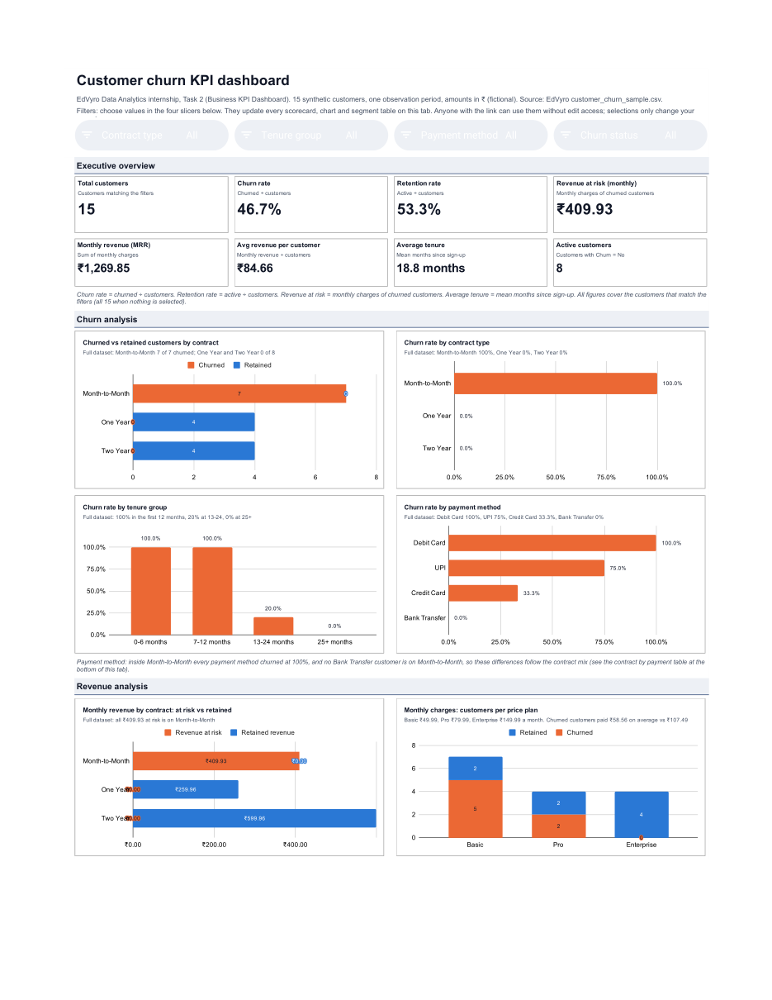

# Google Sheets Dashboard (accepted EdVyro submission platform)

**View-only link:** <https://docs.google.com/spreadsheets/d/1i7BwdceJrBUXdqcdYteQnfCGl6LGgv06dqtX2r1riZY/edit?usp=sharing>

- Sharing: **Anyone with the link → Viewer** (set 19 Nov 2026). Viewers can look at everything and use the filters, but cannot change the file.
- Owner: your Google account. You can edit it at any time; the link stays the same.
- EdVyro lists "spreadsheet dashboard" as an accepted platform for Task 2, alongside Power BI, Tableau and Looker Studio.

## What is in the spreadsheet

| Tab | Contents |
|---|---|
| **Dashboard** | 4 filters (slicers): Contract type, Tenure group, Payment method, Churn status · 8 KPI scorecards · 12 charts in three sections (churn, revenue, segmentation) with a written insight under every chart title · 6 segment tables (contract, tenure, payment, plan, support tickets, contract × payment) |
| **Insights** | Decision question, key findings, high-risk segments, revenue risk, retention opportunities, 6 recommendations, limitations |
| **KPI Check** | 17 KPIs calculated with sheet formulas next to the verified Python values, with a live Match / Check column. Result: *All 17 KPIs match the verified results* |
| **Customers** | The 15 official EdVyro rows (columns A–K, unchanged, sorted by tenure) plus formula columns L–V used by the dashboard |
| **Definitions** | Tenure-group and support-ticket band tables, and the formula for every KPI |

## How the filters work

- The slicers sit at the top of the Dashboard tab. Every scorecard, chart and segment table on that tab follows them.
- **Viewers do not need edit access** to use them. A viewer's choices change only their own view, so reviewers cannot disturb each other or your file.
- To filter: click the small ▾ on a slicer → untick values (or **Clear**, then tick the ones you want) → **OK**.
- To reset: open the slicer → **Select all** → **OK**.
- Choosing *Churn status = Churned* makes the churn rate 100% by definition. That filter is for looking at the churned or retained group, not for reading the rate.

How a filter reaches the numbers: each Customers row carries `Churned` (1 or 0) and `Churn rate` (100% or 0%). Scorecards sum or average those over the rows left in view, and the segment pivot tables do the same per segment, so the average of `Churn rate` is the churn rate of the filtered customers.

## How the numbers were verified

| Check | Result |
|---|---|
| KPI Check tab: 17 sheet formulas vs verified Python values | 17 / 17 Match |
| `tests/test_spreadsheet_export.py`: KPI Check values, all segment-table cells and the 15 data rows, read from the downloaded `.xlsx` and Dashboard `.csv` | 20 / 20 checks pass (136 segment cells) |
| Opened the view-only link **signed out** and used the Payment method slicer as a viewer (UPI only) | 4 customers · 75.0% churn · 25.0% retention · ₹149.97 at risk · ₹199.96 MRR · ₹49.99 ARPU · 7.5 months, exactly the verified UPI values; all charts and tables updated. Screenshots in `screenshots/` |
| Unfiltered view | 15 · 46.7% · 53.3% · ₹409.93 · ₹1,269.85 · ₹84.66 · 18.8 months · 8 active |

## Files in this folder

| File | What it is |
|---|---|
| `Customer_Churn_KPI_Dashboard.xlsx` | Download of the Google Sheet (formulas, charts, pivot tables). Backup copy; the live link above is the submission |
| `Customer_Churn_KPI_Dashboard_export.pdf` | PDF download of all tabs (unfiltered), for anyone who cannot open the link |
| `dashboard_tab_export.csv` | CSV download of the Dashboard tab, used by the test to read the segment-table values |
| `screenshots/` | The signed-out viewer test: unfiltered view, slicer opened, UPI-filtered KPIs and charts |

## If you ever need to rebuild it from the .xlsx

1. Google Drive → **New → File upload** → `Customer_Churn_KPI_Dashboard.xlsx` → open it with Google Sheets → **File → Save as Google Sheets**.
2. The data, formulas, charts and pivot tables come across. Slicers are not stored in .xlsx files, so add them again: on the Dashboard tab, **Data → Add a slicer** → range `Customers!A1:V16` → column `ContractType`. Repeat for `TenureGroup`, `PaymentMethod` and `ChurnStatus`, and drag them into the row under the title.
3. **Share → General access → Anyone with the link → Viewer → Copy link**.
4. Test the link in a private/incognito window.

## Known behaviour

- If a filter leaves only zero values in a chart (for example, only retained customers in a revenue-at-risk chart), Google Sheets draws an empty axis. The scorecards still show 0.
- If a filter combination matches no customers, the scorecards go blank. Reset one of the slicers.
